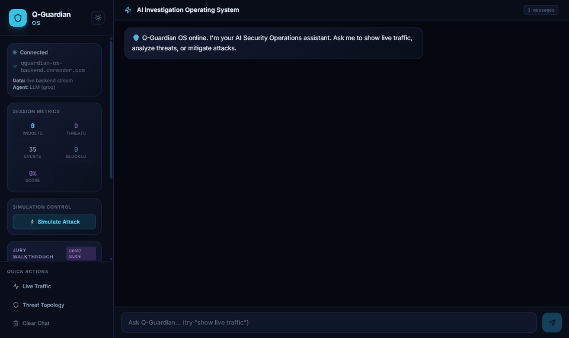
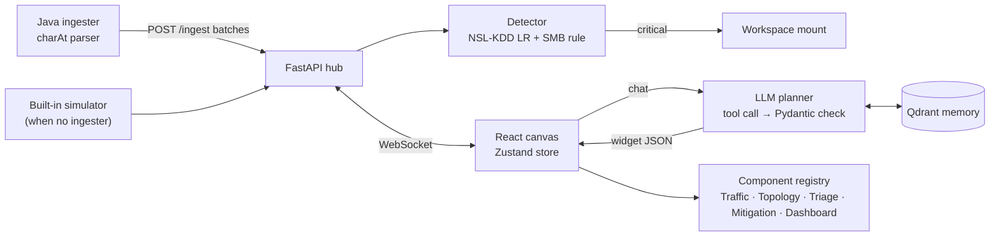
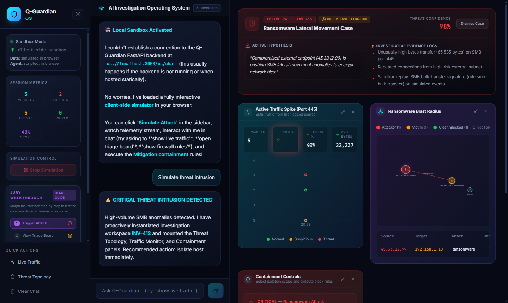

# Q-Guardian OS

**An AI security operations console that rebuilds its own interface around the threat in front of it.**

[](https://github.com/Rishini-Dharan/HackIndia2026/actions/workflows/ci.yml)
· [Live demo](https://rishini-dharan.github.io/HackIndia2026/) · Built for HackIndia Spark-9 2026, Track 04 (stateful AI agents with dynamic UI)



*Recorded on the real pipeline (Java ingester → `/ingest` → detector → WebSocket), not the browser sandbox.*

A Java service parses packet telemetry and streams it to a FastAPI hub. A detector trained on NSL-KDD scores each event. When something critical shows up, the backend opens an investigation workspace, and an LLM planner decides which widgets the analyst needs next: traffic, blast-radius graph, triage board, containment controls, or a generated report. The planner emits validated JSON, and a fixed component registry renders it, so the model never writes UI code.

## What's real and what's simulated

| Part | Status |
|---|---|
| Java ingestion | Real. It parses `ts\|src\|dst\|proto\|port\|bytes\|flags` with a single `charAt` pass and POSTs batches to `/ingest`. The traffic it sends is generated; there is no packet capture. |
| Detector | Real model. Multinomial logistic regression trained on NSL-KDD and evaluated on the held-out `KDDTest+` set (numbers below). Ransomware is a **signature rule** (SMB bulk transfer from an external IP), because NSL-KDD has no ransomware class. Each detection is tagged with its closest MITRE ATT&CK technique: a port scan maps to T1046 Network Service Discovery, the SMB rule to T1486 Data Encrypted for Impact. |
| Planner | Real LLM (Groq `openai/gpt-oss-120b` or OpenAI) when a key is set. Without one, a scripted keyword planner answers. The sidebar always shows which one answered, and a failed LLM call never falls back silently. |
| Memory | Qdrant Cloud on the live demo, so saved cases survive deploys and restarts (checked: a case saved before a full redeploy was restored after it). Locally, an on-disk store (`backend/.qdrant`) is used when `QDRANT_URL` isn't set; `/health` reports which (`memory_store`). Every opened and contained case is saved as a full workspace snapshot; asking the agent to *continue* or *resume* reopens the latest one. Embeddings come from Gemini, or from a deterministic hash when no key is set (the live demo uses the hash). |
| Hosted demo | **Real backend.** The Pages site connects to the FastAPI backend on Render, and the agent answers with `openai/gpt-oss-120b` on Groq. Telemetry there comes from the built-in simulator, because the Java ingester isn't deployed. If the backend is unreachable, the page falls back to a browser sandbox and the sidebar says so. The free Render instance sleeps when idle, so the first load can take up to a minute. |
| Visitors | Each browser gets a private session (client id in localStorage): its own simulated attack, workspace, blocklist, detector window and saved cases. One visitor's actions, including *clear memory*, never reach another. Chat is rate-limited per visitor (10 messages a minute) and across visitors by Groq's own token budget: the backend reads the remaining-tokens header on every response and stops calling the LLM when the next call wouldn't fit, so the scripted planner answers (and the sidebar says so) before Groq ever returns a 429, so one visitor can't exhaust the shared Groq quota. Real telemetry from the Java ingester feeds every session. |

## Numbers

All numbers are reproducible from this repo.

**Detector** (`backend/ml/metrics.json`, trained on 125,973 rows, tested on 22,544 held-out rows that include attack types absent from training):

| | Precision | Recall | F1 |
|---|---|---|---|
| Attack vs normal (argmax) | 0.857 | 0.901 | **0.878** |
| Live alert threshold, P(attack) ≥ 0.95 | **0.967** | 0.622 | |

The model only uses features the runtime can compute from a sliding window (bytes, connection count, service mix, protocol), so a random forest on the same features gets just 0.81 multiclass accuracy against 0.71 for the linear model. The detector stays linear so it runs on NumPy alone. R2L and U2R attacks are mostly missed; they need payload features this pipeline does not see. At the 0.95 threshold, the detector flagged 0 of 2,000 simulated benign events.

**Does it generalize?** (`backend/ml/cross_dataset.json`, UNSW-NB15: a 2015 testbed with nine modern attack families, 82,332 held-out flows, same 11 features)

| Model | F1 | ROC AUC |
|---|---|---|
| Deployed NSL-KDD model, applied to UNSW-NB15 | 0.30 | 0.30 |
| Logistic regression trained on UNSW-NB15 | 0.74 | 0.81 |
| Gradient boosting trained on UNSW-NB15 | 0.84 | 0.94 |

The NSL-KDD model doesn't transfer: on modern traffic it ranks worse than chance. The window features themselves do carry signal, since gradient boosting reaches AUC 0.94 on UNSW-NB15. But that model misreads the demo's simulated traffic: it flags 43% of benign events and misses the synthetic scan and flood. So the live detector stays on NSL-KDD. Moving to UNSW-NB15 first needs a simulator that replays real flows instead of generating its own. Reproduce with `python ml/train.py --dataset unsw ...` and `python ml/compare_datasets.py ...`.

**Ingestion**: about **4.0M records/s** parse and serialize on one core (Java 21, laptop CPU, `java TelemetryIngestion --bench 2000000`, 3 runs: 3.9M to 4.1M).

**Planner eval** (`backend/eval`, pass means the exact set of widgets mounted). `cases.json` (20 requests) was used while writing the prompt; `holdout.json` (12 requests, 3 needing two or three widgets) was written afterwards and never tuned on.

| Planner | Main set (20) | Held-out (12) |
|---|---|---|
| Scripted keyword planner | 16/20 | 6/12 |
| `openai/gpt-oss-120b`, original prompt | **20/20** (two runs) | **12/12** |
| `openai/gpt-oss-120b`, shorter prompt (live) | 19/20 + 1 malformed tool call | **12/12** |
| `openai/gpt-oss-20b`, shorter prompt (live fallback) | **20/20** | 11/12 + 1 malformed tool call |

A *malformed tool call* means the model wrote invalid JSON (a `//` comment inside the arguments) and Groq rejected it. That happens about once per run on either model and either prompt. Live, the planner tries 120b, then 20b, then the scripted planner, so one model's bad call rarely reaches a visitor.

**Capacity.** Groq's free tier meters each model separately at 8,000 tokens a minute. The shorter system prompt cut a call's fixed cost from 1,160 to 831 tokens. Memory context is now capped at three short snippets, and raw chat history is left out. Falling back to `gpt-oss-20b` adds a second budget, so the demo gives roughly twice as many LLM answers per minute before the scripted planner takes over.

The jump from 16 to 20 came from changing the tool, not the prompt: the planner now returns every widget in one `render_security_widgets` call. With one widget per call, the model made one call and dropped the second view of a two-part request. Free Groq tiers cap tokens per minute, so run the eval with `--delay 10`; a run is marked invalid if any case fell back to the scripted planner.

## Architecture



- `telemetry-ingestion/`: Java 17 ingester with stdin, `--simulate`, `--bench` and `--emit URL [--attack]` modes.
- `backend/main.py`: WebSocket `/ws/chat`, `POST /ingest`, `/health` (reports planner mode and telemetry source).
- `backend/ml_detector.py`, `backend/ml/train.py`: detector and training script.
- `backend/llm_orchestrator.py`: planner, tool schema, `WidgetCall` validation, visible fallback.
- `backend/ws_handler.py`: actions (isolate, false positive, report), and investigation state saved to Qdrant.
- `frontend/src/store/useWebSocketStore.ts`: socket state, plus the browser sandbox used when no backend answers.

## Run it

```bash
# full stack: ingester -> backend -> UI on http://localhost:3000
GROQ_API_KEY=gsk_... docker compose up --build

# or piece by piece
cd backend && pip install -r requirements.txt && uvicorn main:app --reload
cd frontend && npm ci && npm run dev
cd telemetry-ingestion && javac TelemetryIngestion.java && java TelemetryIngestion --emit http://localhost:8000/ingest --attack
```

`--attack` adds an SMB bulk-transfer source. The detector flags it, and the workspace opens with evidence taken from that event.

Optional `.env` in the repo root: `GROQ_API_KEY`, `OPENAI_API_KEY`, `GEMINI_API_KEY`, `QDRANT_URL`, `QDRANT_API_KEY`, `LLM_PROVIDER` (`groq`/`openai`/`ollama`/`mock`).

## Tests and reproducing the numbers

```bash
cd backend && pytest -q                               # detector, planner validation and fallback, /ingest → WebSocket
python ml/train.py --train KDDTrain+.txt --test KDDTest+.txt   # NSL-KDD: https://www.unb.ca/cic/datasets/nsl.html
python eval/run_eval.py                               # planner eval
cd telemetry-ingestion && java TelemetryIngestion --bench 2000000
```

CI runs the backend tests, compiles and smoke-tests the Java parser, and builds the frontend on every push.

## Deploying the backend

Set `QG_INGEST_TOKEN` on any public deployment (`render.yaml` generates one) and give the same value to the ingester, which sends it as `X-Ingest-Token`. `QG_WS_TOKEN` (frontend: `VITE_WS_TOKEN`) locks the WebSocket for private deployments. Don't set it for the public demo: a token in a static bundle is visible to anyone.


`render.yaml` deploys the backend as a Render web service. After it is up, set the repository variable `VITE_WS_URL=wss://<service>.onrender.com/ws/chat` and re-run the Pages workflow, and the live demo will use the real backend instead of the sandbox.

## Hackathon material

The original submission README, jury walkthrough and pitch script are in [`docs/hackathon/`](docs/hackathon/).


